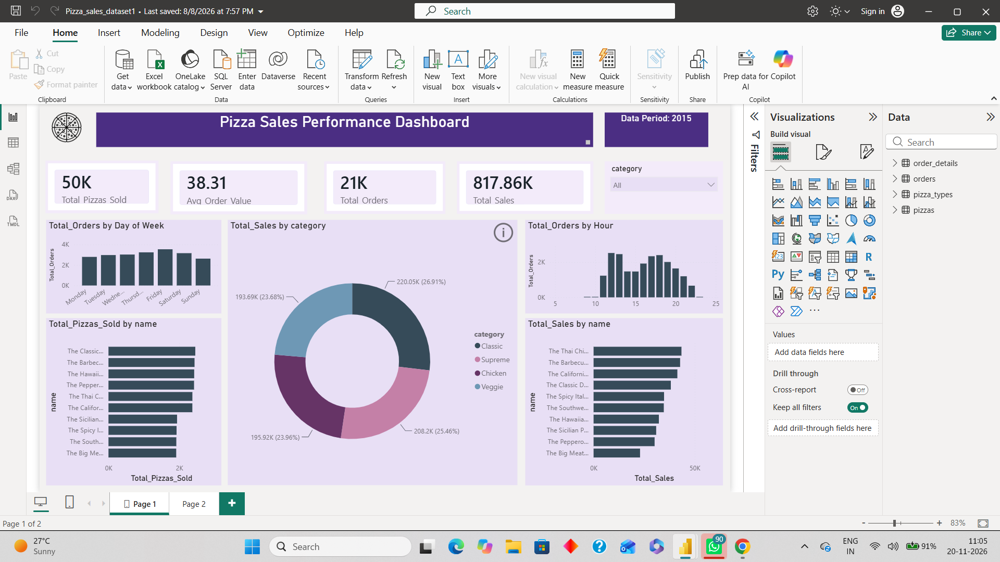
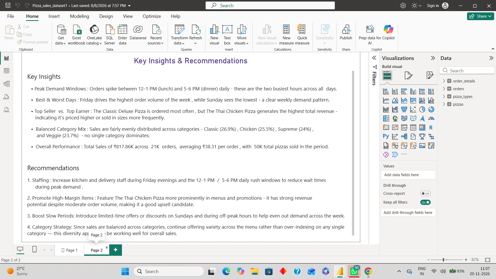

# 🍕 Pizza Sales Performance Dashboard (Power BI)

An interactive Power BI dashboard that analyzes one year (2015) of pizza sales data to understand what sells, when it sells, and how much revenue each category and pizza generates.

---

## 📌 Project Overview

A pizza restaurant wants to understand its sales performance. This project turns raw transaction data (orders, order items, pizza types and prices) into a clear dashboard that answers business questions such as:

- How many pizzas were sold and how much revenue was generated?
- What is the average value of an order?
- Which days and hours get the most orders?
- Which pizza categories and individual pizzas perform best?

---

## 📊 Key Metrics (KPIs)

| Metric | Value |
|---|---|
| Total Pizzas Sold | ~50K |
| Total Orders | ~21K |
| Total Sales | ~817.86K |
| Average Order Value | 38.31 |

---

## 📈 Dashboard Visuals

- *KPI Cards:* Total Pizzas Sold, Avg Order Value, Total Orders, Total Sales
- *Total Orders by Day of Week:* busiest and slowest days
- *Total Orders by Hour:* peak ordering hours
- *Total Sales by Category (Donut Chart):* Classic, Supreme, Chicken, Veggie
- *Total Pizzas Sold by Name:* top-selling pizzas by quantity
- *Total Sales by Name:* top pizzas by revenue
- *Category Slicer:* filter the whole dashboard by pizza category

### Sales by Category

| Category | Sales | Share |
|---|---|---|
| Classic | 220.05K | 26.91% |
| Supreme | 208.2K | 25.46% |
| Chicken | 195.92K | 23.96% |
| Veggie | 193.69K | 23.68% |

---

## 🗂️ Dataset

The data comes from 4 related tables:

| Table | Rows | Description |
|---|---|---|
| orders | 21,350 | Order ID, date, time of each order |
| order_details | 48,620 | Order ID, pizza ID and quantity for every item ordered |
| pizzas | 96 | Pizza ID, pizza type, size (S/M/L) and price |
| pizza_types | 32 | Pizza name, category and ingredients |

*Data period:* 2015

### Data Model

The model follows a star-style design: order_details is the central fact table, connected to the other tables with *one-to-many* relationships (single direction).

orders (1)      ──< order_details (*)   on order_id
pizzas (1)      ──< order_details (*)   on pizza_id
pizza_types (1) ──< pizzas (*)          on pizza_type_id

---

## 🛠️ Tools & Skills Used

- *Power BI Desktop*: data modeling, visualization, dashboard design
- *Power Query*: data loading and cleaning
- *DAX*: measures such as Total Sales, Total Orders, Total Pizzas Sold and Average Order Value
- *Data Modeling*: relationships between the four tables

### Columns Added in orders

Hour, Day of Week, Time of Day (Morning / Afternoon / etc.) and DayNum (used to sort days correctly from Monday to Sunday).

---

## 📁 Repository Structure

├── Pizza_sales_dataset1.pbix     # Power BI dashboard file
├── orders.csv
├── order_details.csv
├── pizzas.csv
├── pizza_types.csv
├── dashboard2..png               # Dashboard screenshot
├── dashboard3..png               # Data model screenshot
└── README.md

---

## 🚀 How to Use

1. Download or clone this repository.
2. Open Pizza_sales_dataset1.pbix in *Power BI Desktop*.
3. If prompted, update the data source path to the folder where you saved the CSV files (Transform data → Data source settings).
4. Click *Refresh* and explore the dashboard using the category slicer.

---

## 💡 Insights

- Classic is the top category by sales (about 27% of total revenue), but all four categories are close, so revenue is fairly evenly spread.
- Orders are spread across the whole week, with Friday and Saturday looking strongest on the chart.
- Orders cluster around lunch and evening hours.

---

## 👤 Author

*Ankit Thakur*
- GitHub: [ankitthakur49757-maker](https://github.com/ankitthakur49757-maker)
- Email: ankitthakur49757@gmail.com
